# HC-SR04

## Table of Contents
- [1. 개요](#1-개요)
- [2. Hardware 구성](#2-hardware-구성)
- [3. CubeMX 설정](#3-cubemx-설정)
- [4. Firmware](#4-firmware)
- [5. 측정 결과](#5-측정-결과)
- [6. 참고](#6-참고)

## 1. 개요

HC-SR04는 초음파를 송신(Transmitter)하고, 물체에 반사되어 돌아온 초음파를 수신(Receiver)하여 거리를 측정하는 센서이다.

### 1.1 모듈 및 회로도

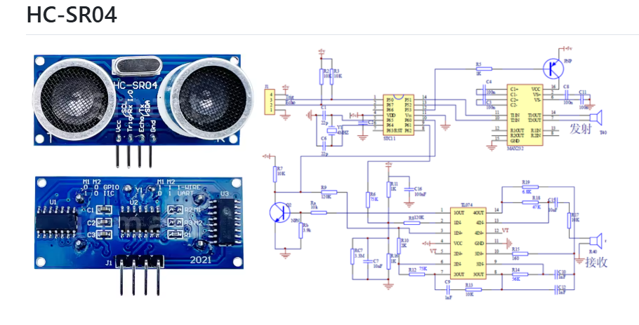

### 1.2 핀 구성 및 동작 원리

핀은 VCC, Trig, Echo, GND 4개로 구성된다.

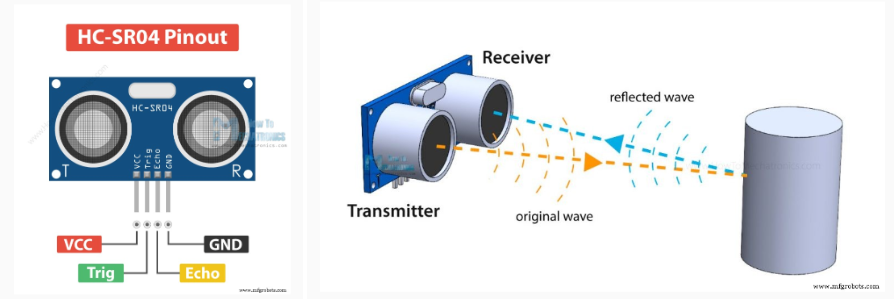

### 1.3 타이밍 및 거리 계산

- Trig 핀에 10 µs 펄스를 인가하면 8 cycle의 초음파가 송신된다.
- Echo 핀은 초음파가 반사되어 돌아올 때까지 HIGH를 유지하며, HIGH 시간이 거리에 비례한다.
- Distance = (Speed × Time) / 2 (왕복 거리이므로 2로 나눈다.)
- 예) Time = 1.5 ms, Speed = 340 m/s (34 cm/ms) → Distance = (34 cm/ms × 1.5 ms) / 2 = 25.5 cm

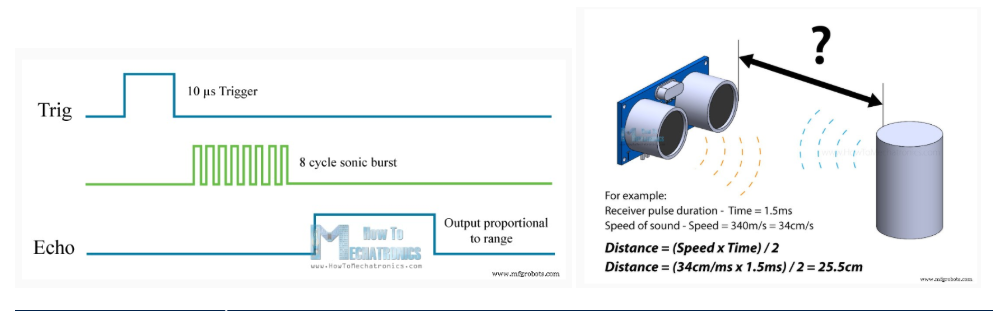

## 2. Hardware 구성

- MCU: STM32F411RE
- Board: NUCLEO-F411RE
- Sensor: HC-SR04
- IDE: STM32CubeIDE
- Oscilloscope: Tektronix TDS 2012B

| 신호 | 핀 | CubeMX Label |
|------|----|--------------|
| Trig | PA0 | TRIGER1 |
| Echo | PA1 | ECHO1 |
| USART2 TX | PA2 | USART_TX |
| USART2 RX | PA3 | USART_RX |

NUCLEO-F411RE 보드와 HC-SR04를 연결하고, 오실로스코프 프로브로 신호를 측정하였다.

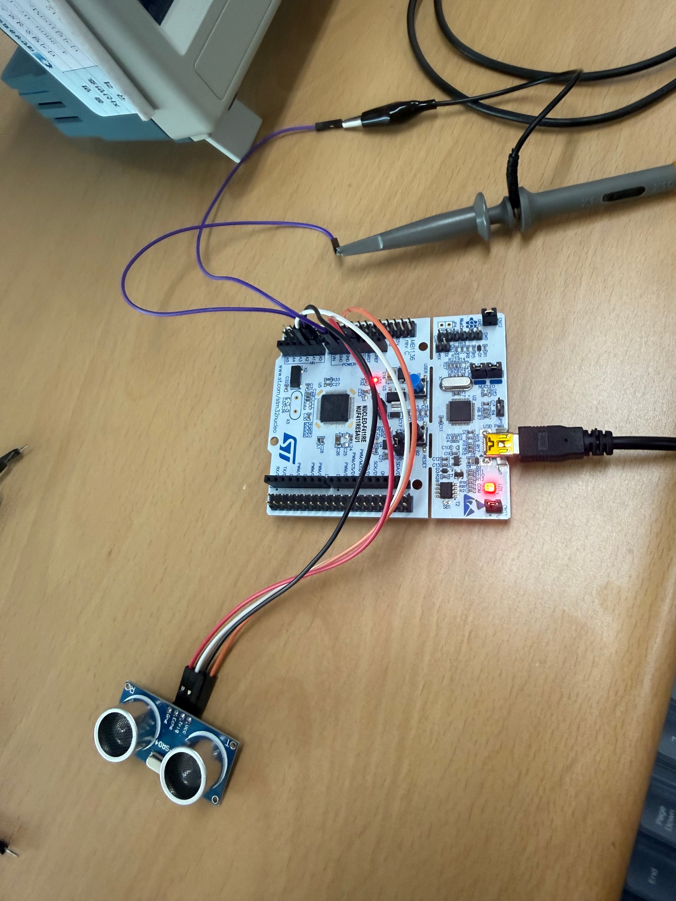

## 3. CubeMX 설정

### 3.1 Project Manager

- Project Name: F411_HC-SR04
- Toolchain / IDE: STM32CubeIDE (Generate Under Root)
- Mcu Reference: STM32F411RETx
- Firmware Package: STM32Cube FW_F4 V1.28.3

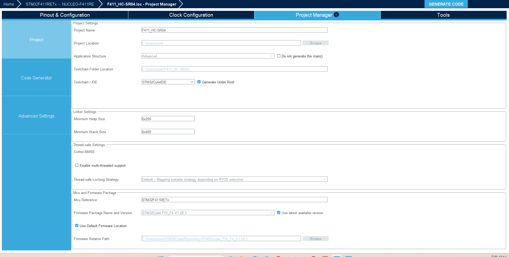

### 3.2 Pinout

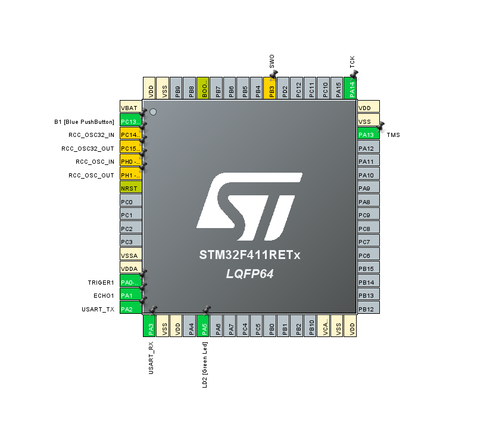

### 3.3 TIM1 설정

| 항목 | 값 |
|------|----|
| Clock Source | Internal Clock |
| Prescaler (PSC - 16 bits value) | 84-1 |
| Counter Mode | Up |
| Counter Period (AutoReload Register - 16 bits) | 65535 |
| Internal Clock Division (CKD) | No Division |
| Repetition Counter (RCR) | 0 |
| auto-reload preload | Enable |

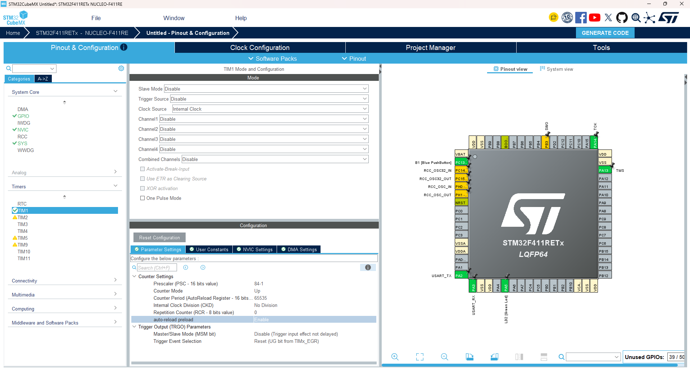

## 4. Firmware

### 4.1 main 루프 (HAL_Delay(1))

초기화 후 `timer_start()`를 호출하고, 루프에서 `trig()` 호출 뒤 `HAL_Delay(1)`로 대기한다.

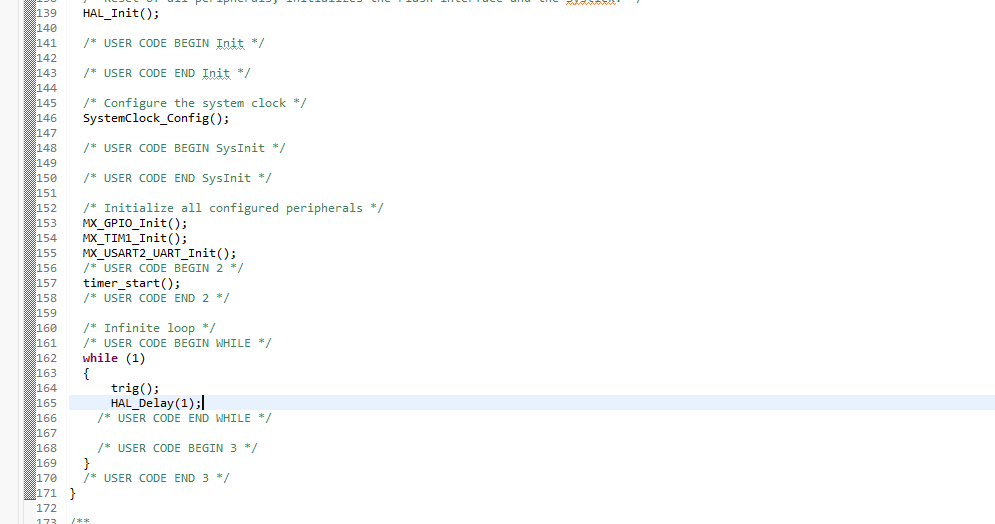

### 4.2 main 루프 (delay_us(200))

`HAL_Delay(2)`를 주석 처리하고 `delay_us(200)`으로 변경하였다.

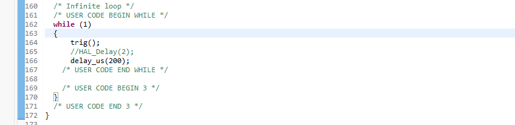

### 4.3 echo() 함수

Echo 신호의 HIGH 유지 시간을 TIM1 카운터 값으로 측정하여 반환한다.

- Echo가 HIGH가 될 때까지 대기 (최대 10 ms, 초과 시 0 반환)
- 시작 시점의 `__HAL_TIM_GET_COUNTER(&htim1)` 저장
- Echo가 LOW가 될 때까지 대기 (최대 30 ms, 초과 시 0 반환)
- 종료 시점의 카운터 값에서 시작 값을 뺀 `end_time - start_time` 반환

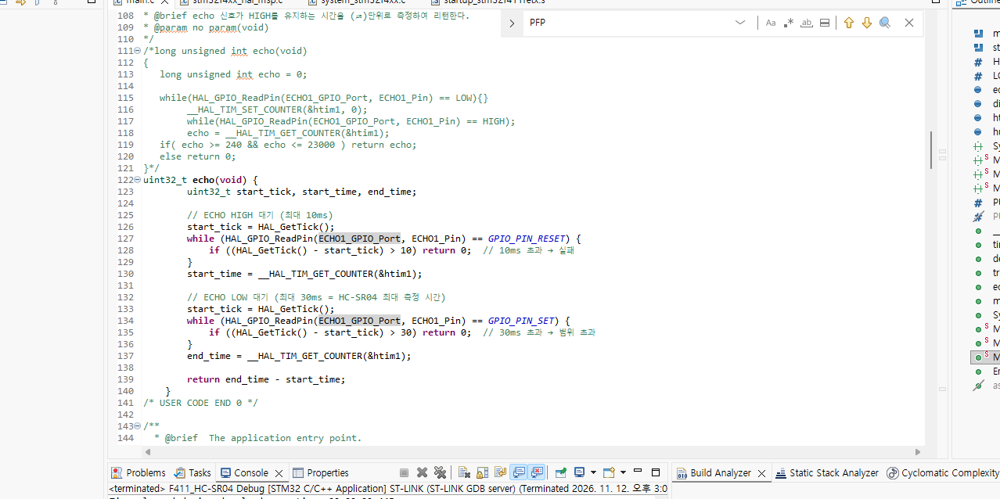

## 5. 측정 결과

### 5.1 Trig 신호 - HAL_Delay(1)

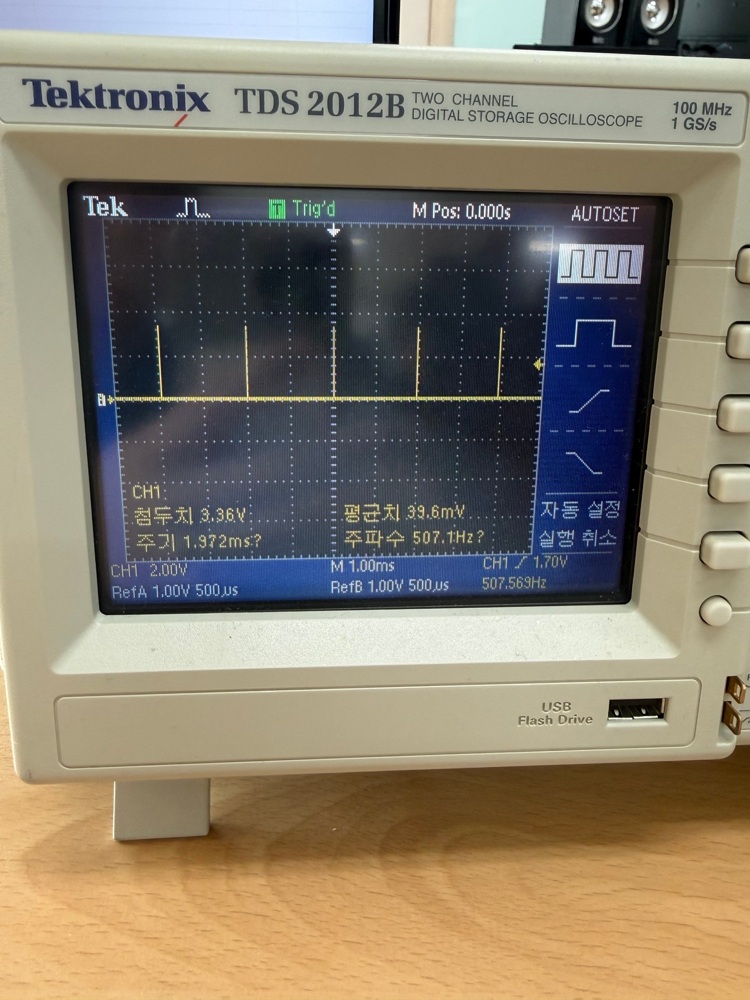

- 최대치 3.36 V
- 주기 1.972 ms (주파수 507.1 Hz)
- 시간축 1.00 ms/div

### 5.2 Trig 신호 - delay_us(200)

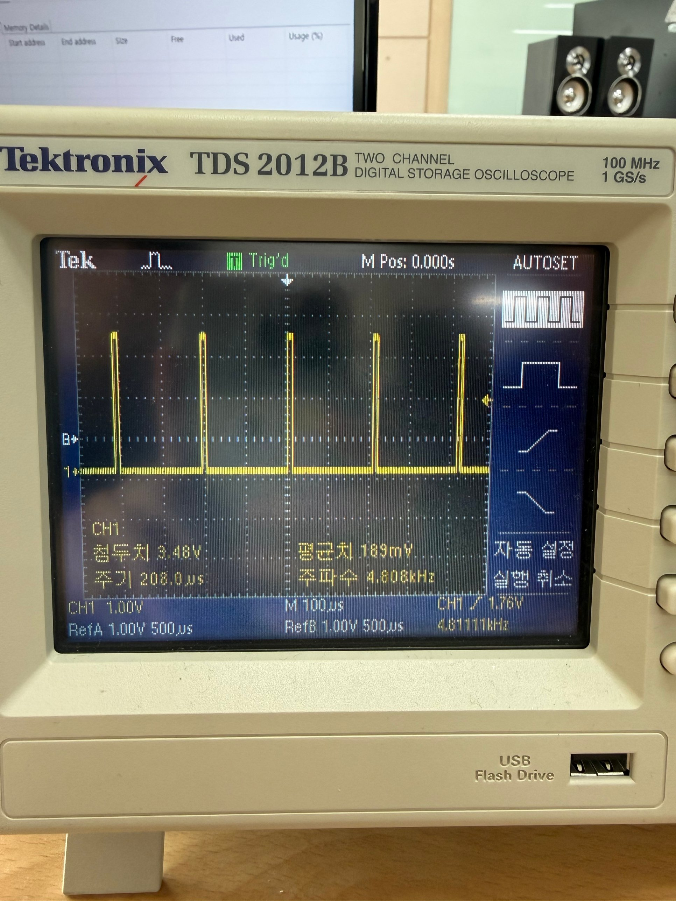

- 최대치 3.48 V
- 주기 208.0 µs (주파수 4.808 kHz)
- 시간축 100 µs/div

### 5.3 Echo 신호

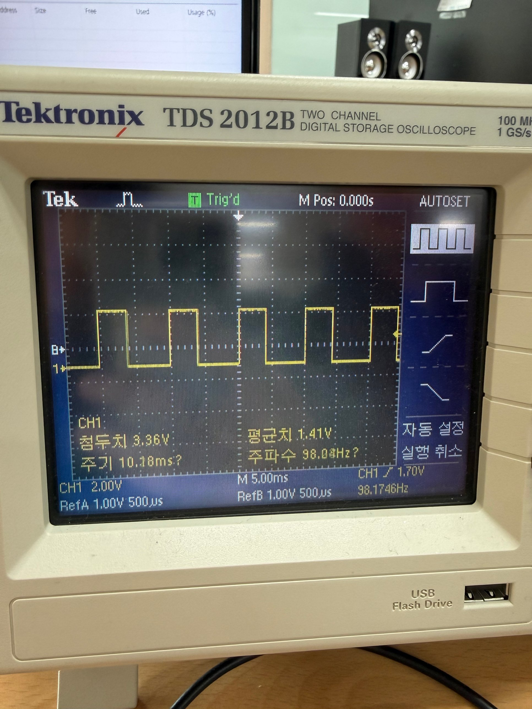

- 최대치 3.36 V
- 주기 10.18 ms (주파수 98.08 Hz)
- 시간축 5.00 ms/div

### 5.4 거리 측정 결과 (PuTTY)

USART2를 통해 PuTTY(COM9)로 측정한 거리를 mm 단위로 출력하였다.

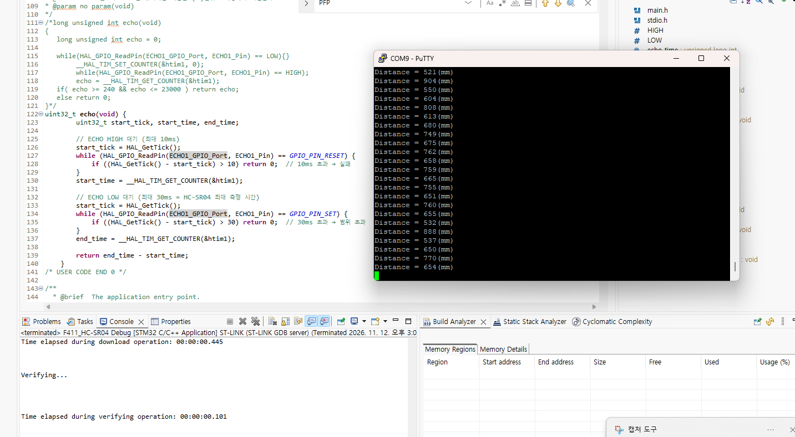

## 6. 참고

HC-SR04를 다른 보드에서 사용하는 예시이다. 본 실험은 NUCLEO-F411RE 보드를 사용하였다.

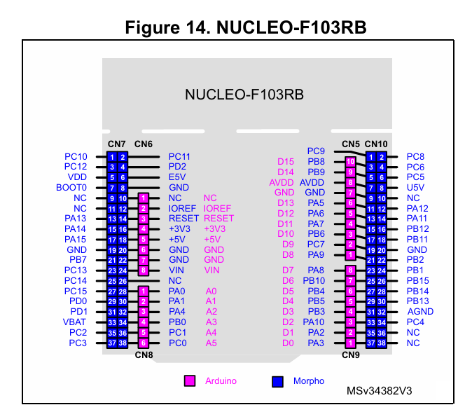

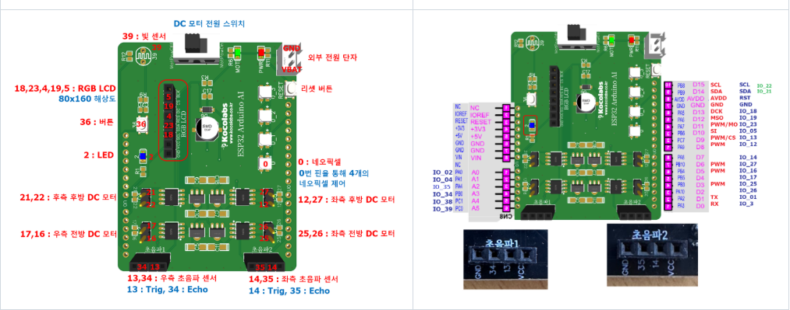
