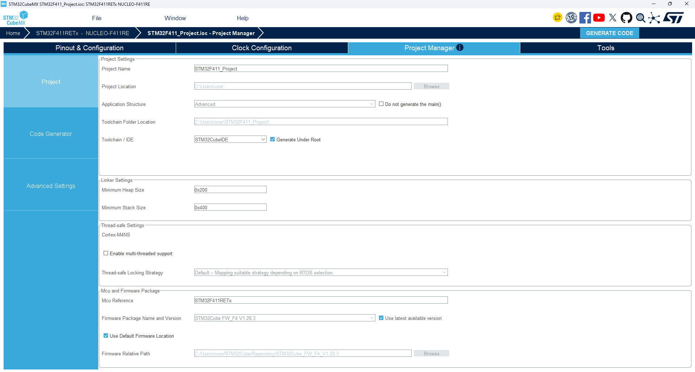
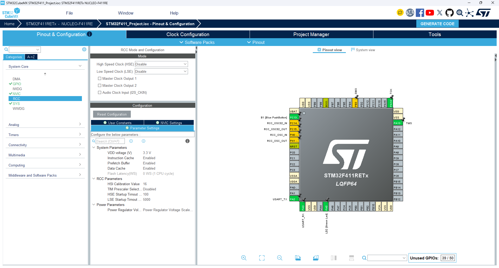
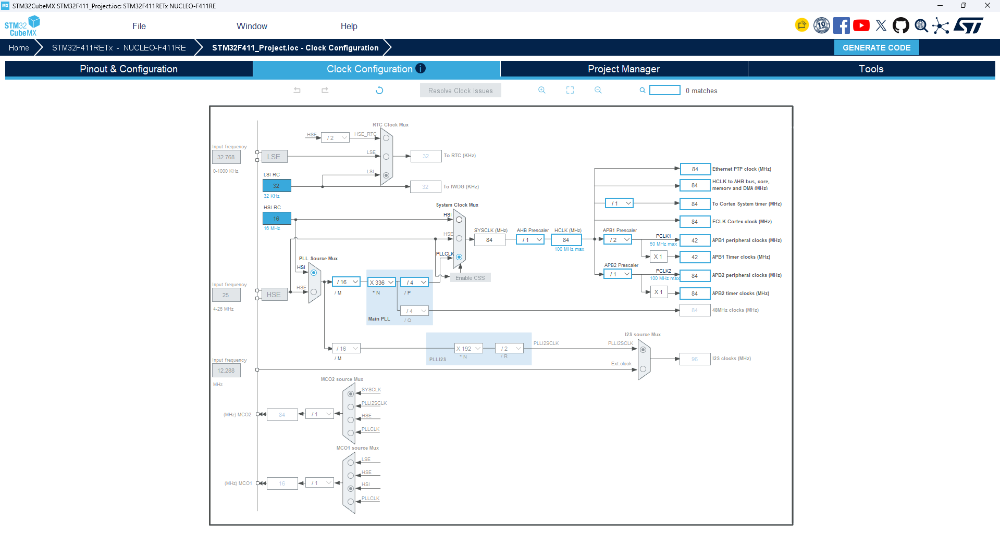

# STM32F411_Project
STM32F411_Project_test
<<<<<<< HEAD
=======

#STM32F4111 Project

## Hardware


---


##Firmware

- RCC-Disable

---
- CLOCK

---
- 프로젝트 생성

---
```
  /* Infinite loop */
  /* USER CODE BEGIN WHILE */
  while (1)
  {
    /* USER CODE END WHILE */

    /* USER CODE BEGIN 3 */
  }
  /* USER CODE END 3 */
}
```
