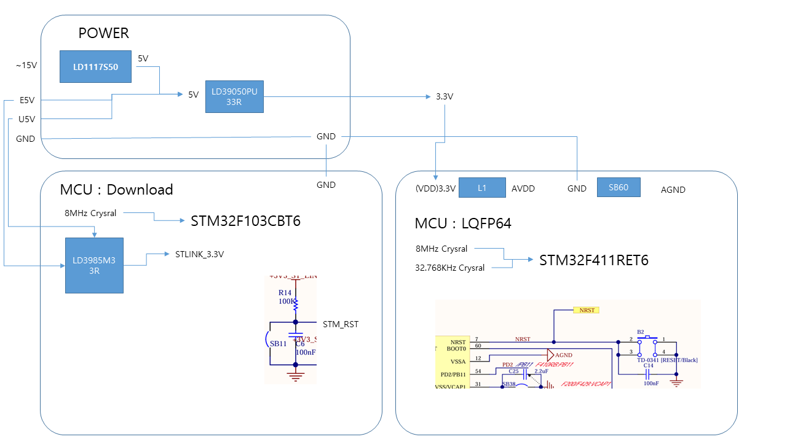
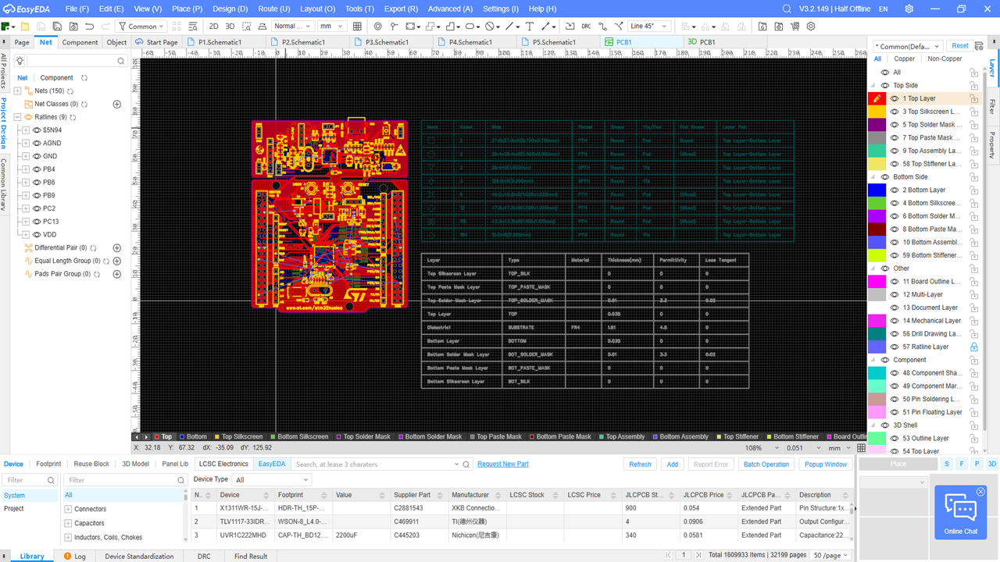
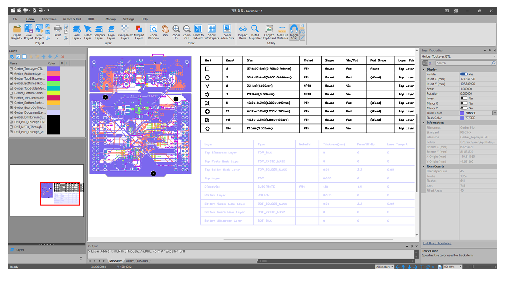
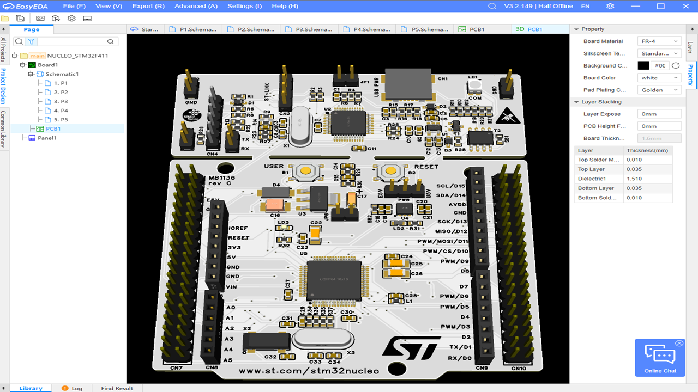
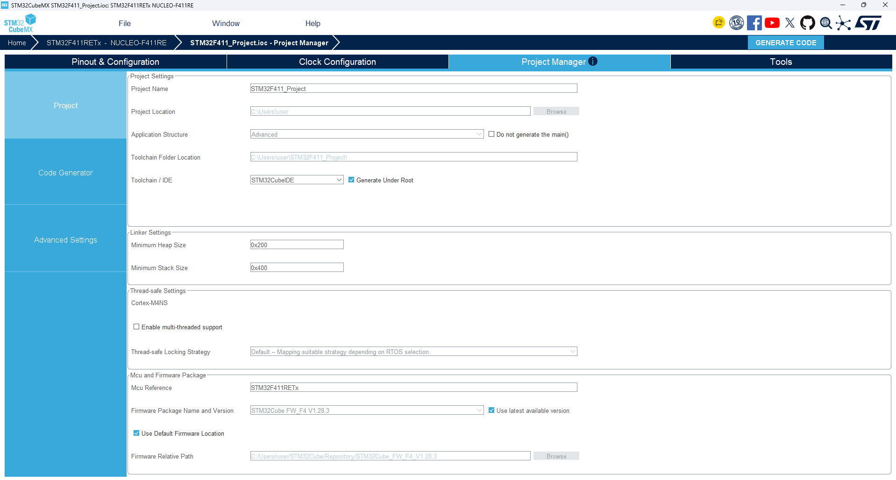
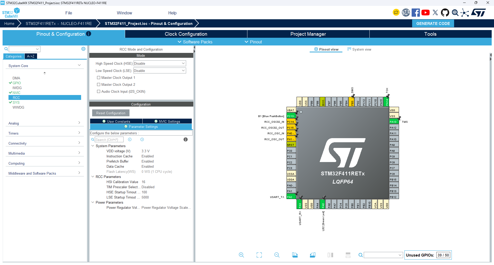
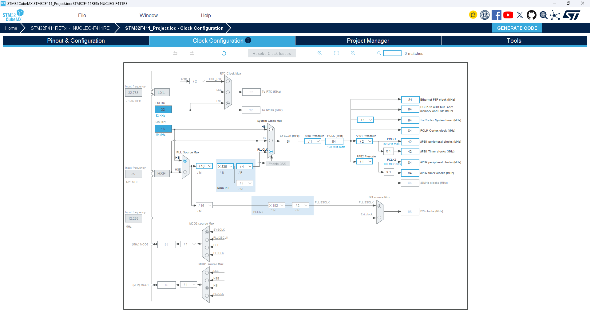

# STM32F411_Project
STM32F411_Project test

## Hardware

 <br>
 <br>
 <br>
 <br>
 <br>
 <br>
 <br>

---

## Firmware

* RCC : Disable
  
 <br>

* CLOCK
  
 <br>

* 프로젝트 생성
  
 <br>

```
  /* Infinite loop */
  /* USER CODE BEGIN WHILE */
  while (1)
  {
    /* USER CODE END WHILE */

    /* USER CODE BEGIN 3 */
  }
  /* USER CODE END 3 */
}
```
